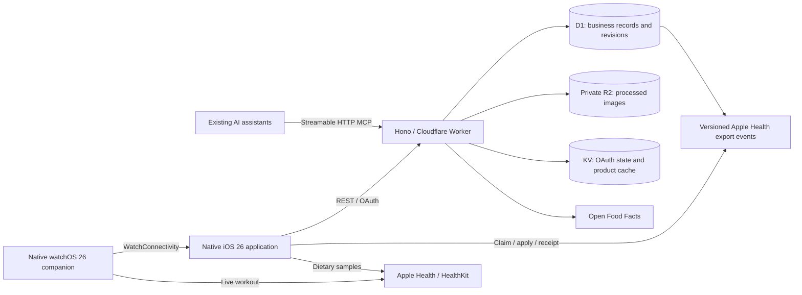

# OpenFitness

An open-source, headless fitness service for AI assistants and native clients.

OpenFitness owns your training plans, workout history, reusable recipes, and meal records. Existing assistants such as a Grok bot, Dot, or Muse connect through **MCP**. They handle conversation, planning, exercise guidance, food recognition, and image processing; OpenFitness validates and stores their structured operations.

**Status:** server plus native iPhone and Apple Watch clients. Single owner, English and Simplified Chinese, MIT license. The iOS/watchOS 26 applications, HealthKit bridge and device delivery protocol are implemented locally; physical device signing, production authorization and actual sensor/HealthKit delivery require device acceptance. See the [native app guide](apps/ios/README.md).

## Architecture



Both transports use the same validated application operations. The service uses Hono 4, the official MCP TypeScript SDK 2, Cloudflare's OAuth Provider 1, SimpleWebAuthn 14, and Zod 4. MCP serves modern requests and stateless legacy Streamable HTTP requests through the SDK's compatibility handler.

| Layer                    | Responsibility                                                        |
| ------------------------ | --------------------------------------------------------------------- |
| Domain services          | Training, nutrition, recipes, meals, immutable snapshots, idempotency |
| Repository interface     | Versioned records, history, atomic commits, health outbox             |
| D1 adapter               | Prepared SQLite statements, transactional batches, version guards     |
| Object storage interface | Binary storage and private reads; R2 is the first implementation      |
| Cache interface          | Open Food Facts snapshots and advisory request throttling             |
| Authentication adapter   | Owner passkeys, sessions, OAuth, verified agent identities            |

D1 is the business source of truth. KV also persists the official OAuth provider's client registrations, grants, and tokens; it is not restricted to caching. R2 stores files, while D1 stores asset IDs and metadata. Versioned entities are typed JSON documents indexed by owner, kind, and ID. Revisions are append-only database snapshots, not a whole-account synchronization blob.

Postgres, alternate object stores, Vercel, and self-hosted runtimes can implement these interfaces later. Only Cloudflare adapters and the Cloudflare runtime entry point are included today; changing providers is not yet a configuration-only switch.

## Quick start

This repository is a lightweight monorepo:

```text
open-fitness/
  apps/server/       Hono, MCP, authentication, D1/R2/KV adapters, and server tests
  apps/ios/          Native iOS/watchOS 26 apps, Xcode project, and UI tests
  packages/OpenFitnessKit/ Shared Swift models, OAuth client, localization, and retry contracts
  scripts/           Deterministic Xcode project and local icon generators
  docs/             Project-wide contribution and architecture documentation
  .github/          Shared continuous integration
```

Future Android projects belong under `apps/android`. Native clients consume the versioned REST contracts; they do not import TypeScript business code. The shared Swift package has two concrete consumers: iPhone and Apple Watch. Root server commands delegate to `@openfitness/server`; `apple:*` commands build and validate the native clients on macOS.

Requirements: Node.js 24 LTS or newer and pnpm 11. A Cloudflare account is not required for local development or automated acceptance tests.

```sh
pnpm install --frozen-lockfile
cp apps/server/.dev.vars.example apps/server/.dev.vars
```

Set `SETUP_TOKEN` in `apps/server/.dev.vars` to a new random secret of at least 32 characters. Generate one locally with:

```sh
node --input-type=module -e 'import { randomBytes } from "node:crypto"; console.log(randomBytes(32).toString("base64url"))'
```

Keep `PUBLIC_BASE_URL=http://localhost:8787` for local development. Then:

```sh
pnpm db:migrate
pnpm dev
```

Open `http://localhost:8787/setup`, enter your setup token, and register your first passkey. Setup closes after successful enrollment. Add a backup passkey from the administration page, preferably on another authenticator. Sign-in and authorization pages support English and Simplified Chinese.

The placeholder resource IDs in `apps/server/wrangler.jsonc` are for local simulation only. Production deployment requires your own resources and IDs.

## Connect an assistant

1. Add `https://YOUR_HOST/mcp` as a remote MCP server in a client that supports Streamable HTTP and OAuth. Use `http://localhost:8787/mcp` only when the client runs on your computer; a hosted client cannot reach your localhost.
2. Let the client discover authorization metadata and use authorization code flow with S256 PKCE. CIMD and dynamic client registration are supported.
3. Sign in with your passkey and approve the client. All approved assistants receive `fitness:full` business access. `offline_access` permits refresh tokens.
4. Call `get_agent_context` first. It returns the server-assigned agent ID, owner ID, role, locale, time zone, capabilities, and versioned coaching instructions.
5. Re-read the context at the beginning of a new conversation. Revoke individual connections from `/admin` when needed.

The canonical OAuth resource identifier is `PUBLIC_BASE_URL` without a trailing slash. Its tokens cover this OpenFitness service's MCP and REST operations. The authorization server is discovered at `/.well-known/oauth-authorization-server`; protected-resource metadata is at `/.well-known/oauth-protected-resource`.

Client display names are supplied by clients; a name such as “Grok” is not proof of the provider's identity. The verified identity is the server-issued connection and its owner-approved grant. The assistant host must support adding the remote MCP connection; reading this README alone cannot install a connector or confer execution capabilities.

### Assistant working protocol

- Read existing plans, exercises, recipes, and history before creating duplicates.
- Keep intended training targets separate from actual performed sets. Log actual results and effort after user feedback.
- Reuse a saved restaurant meal or recipe when its portion is applicable. Ask for missing weights or conversion information.
- Preserve user names and notes verbatim, in any language. Code and protocol identifiers remain English.
- Label estimated nutrition with `source.kind = "bot_estimate"` and a meaningful `source.basis`.
- Generate one `operationId` for a logical write and reuse it for retries. Read the current `version` and send `expectedVersion` when changing a record. Use a new operation ID for a different action.
- Treat a one-time portion change as a meal correction. Change the recipe only when the standard future serving changes.
- Use the assistant's image tools for background removal, centering, and visual cleanup before saving a recipe cover.
- Report `awaiting_device` honestly. The server does not currently write into HealthKit.
- A native iPhone may additionally request `health:sync` with explicit owner approval. Assistants should inspect delivery status and never fabricate a device receipt.

## Operations and REST API

The complete English OpenAPI document is served at `/openapi.json`. MCP tools are generated from the same operation registry and schemas.

| Capability                | Representative tools                                                                                                          | REST resources                                                                                             |
| ------------------------- | ----------------------------------------------------------------------------------------------------------------------------- | ---------------------------------------------------------------------------------------------------------- |
| Identity and preferences  | `get_agent_context`, `set_preferences`                                                                                        | `/api/v1/agent-context`, `/api/v1/preferences`                                                             |
| Exercises                 | `search_exercises`, `save_exercise`, `get_exercise_history`                                                                   | `/api/v1/exercises`                                                                                        |
| Plans                     | `save_training_plan`, `list_training_plans`                                                                                   | `/api/v1/training-plans`                                                                                   |
| Training                  | `start_workout`, `log_workout_set`, `revise_workout_set`, `finish_workout`, `cancel_workout`                                  | `/api/v1/workouts`                                                                                         |
| Food and calculation      | `lookup_food`, `search_food_catalog`, `save_food`, `calculate_nutrition`                                                      | `/api/v1/foods`, `/api/v1/food-catalog`, `/api/v1/nutrition/calculate`                                     |
| Recipes                   | `search_recipes`, `save_recipe`                                                                                               | `/api/v1/recipes`                                                                                          |
| Meals                     | `log_meal`, `log_meal_from_recipe`, `revise_meal`, `get_daily_nutrition`                                                      | `/api/v1/meals`, `/api/v1/nutrition/daily/{day}`                                                           |
| Media                     | `create_media_upload`, `complete_media_upload`, `import_recipe_image`, `attach_recipe_image`                                  | `/api/v1/media`                                                                                            |
| Export status and history | `list_health_exports`, `get_record_revisions`                                                                                 | `/api/v1/health/exports`, `/api/v1/history/{kind}/{id}`                                                    |
| Native health delivery    | `enroll_health_device`, `select_health_writer`, `claim_health_exports`, `acknowledge_health_export`, `get_health_sync_status` | `/api/v1/health/devices`, `/api/v1/health/writer`, `/api/v1/health/exports/claim`, `/api/v1/health/status` |
| Consented health cache    | `get_health_snapshot`, `upload_health_snapshot`                                                                               | `/api/v1/health/snapshot`                                                                                  |

Save operations use POST for both creation and explicit versioned updates; include `id` and `expectedVersion` to update. Meals and sets have dedicated PUT correction endpoints. List endpoints accept `query`, `limit` (1–100), and `cursor`. Store and replay the cursor as an opaque value. HTTP results use `{ "data": ... }`; business failures use `{ "error": { "code": "...", "message": "...", "details": ... } }`. MCP tool results expose the same envelope as structured content and text.

REST accepts the agent's OAuth bearer token. A signed-in owner's browser may also use its same-origin session. Cookie-authenticated writes require the configured Origin. Additional browser MCP origins can be explicitly configured in `ALLOWED_ORIGINS`; requests without an Origin header, such as server-side MCP clients, remain supported.

### Nutrition snapshots and portions

A food declares nutrients for an explicit basis, such as 100 g, 100 ml, or one serving. Supported nutrient fields are `energyKcal`, `proteinG`, `carbohydrateG`, `fatG`, and `fiberG`. Unknown nutrients remain `null`, including in totals that depend on them; they are never silently replaced with zero. The service uses supplied energy values rather than inventing missing calories from partial macros.

Grams and milliliters require an explicit density when conversion is needed. “One serving” requires a declared serving size unless the food's nutrition basis is already a serving. Store raw/cooked/as-sold preparation and explain estimates. Image beautification never recalculates nutrition.

Example input for `save_recipe` (illustrative values, not a nutrition reference):

```json
{
  "operationId": "recipe-create-example-0001",
  "data": {
    "name": "Shaxian chicken leg rice",
    "aliases": ["My regular chicken rice"],
    "restaurant": "My regular restaurant",
    "specification": "Standard serving",
    "yield": { "servings": 1 },
    "ingredients": [
      {
        "id": "rice",
        "quantity": 200,
        "unit": "g",
        "food": {
          "name": "Cooked rice",
          "preparation": "cooked",
          "basis": { "quantity": 100, "unit": "g" },
          "nutrients": { "energyKcal": 130, "proteinG": 2.7, "carbohydrateG": 28, "fatG": 0.3 },
          "source": {
            "kind": "bot_estimate",
            "basis": "Illustrative estimate; replace with the user's actual ingredients."
          }
        }
      },
      {
        "id": "chicken",
        "quantity": 140,
        "unit": "g",
        "food": {
          "name": "Cooked chicken leg",
          "preparation": "cooked",
          "basis": { "quantity": 100, "unit": "g" },
          "nutrients": { "energyKcal": 200, "proteinG": 25, "carbohydrateG": 0, "fatG": 10 },
          "source": {
            "kind": "bot_estimate",
            "basis": "Illustrative estimate; cooking method and edible weight must be confirmed."
          }
        }
      }
    ]
  }
}
```

A recipe describes a complete batch and its yield. `log_meal_from_recipe` accepts either `servings` or `grams`. Servings scale snapshots by `servings / yield.servings`; grams require `yield.cookedWeightGrams` and scale by the fraction of the cooked batch eaten. If the recipe declares only a cooked weight, `yield.servings` defaults to one whole batch.

Overrides then replace individual ingredient quantities with **absolute amounts for the entire recorded meal**; they are not percentages. An override quantity of zero removes that ingredient's contribution. For example, `{"ingredientId":"rice","quantity":100,"unit":"g"}` records 100 g of rice in this meal. Use `additions` for extra ingredients such as an egg or more chicken, each with its own quantity and food snapshot or food ID. `revise_meal` supports the same additions and overrides. These adjustments never edit the saved recipe.

Recipe edits create a new nutritional version for future meals. Each meal preserves its recipe version, ingredient snapshots, and calculated nutrients. A cover replacement changes the record version for concurrency control but leaves `nutritionVersion` and calculated nutrients unchanged.

Open Food Facts is primarily a product catalog. Missing restaurant and ingredient data can be supplied as explicit user data or labeled agent estimates. The adapter identifies OpenFitness, caches product responses for 24 hours, and reports rate limits and outages. KV throttling is advisory across locations; callers must also honor upstream errors and retry later. The service does not automatically publish user data back to Open Food Facts.

### Training

Plans contain ordered exercises, target sets, rest periods, and optional group identifiers. Actual sets support reps, kilograms, seconds, meters, RPE/RIR, working/warmup/drop/rest-pause/failure types, and notes. A workout saves its plan and exercise snapshots; editing a plan does not rewrite an existing workout. Completed workouts permit explicit set corrections with version history. Plan generation, progression decisions, and movement analysis belong to the connected assistant.

Native clients pin `planVersion` when starting cached training and `recipeVersion` when logging a displayed recipe. The server resolves the owner's immutable revision, so a later template edit cannot silently change an offline session or the portion the user chose. Omitting these optional selectors uses the current template.

### Private images

The server accepts JPEG, PNG, and WebP up to 10 MiB by default. It checks file signatures, dimensions, declared upload type, and byte limits. It stores agent-prepared images; it does not run background removal or image generation itself.

- `import_recipe_image` fetches a public HTTPS image, rejects redirects/private address literals, and relies on Workers' `global_fetch_strictly_public` compatibility flag to block private-network resolution. Source query strings are not retained in media provenance.
- `create_media_upload` returns a ten-minute, single-use PUT URL. Upload binary bytes using that URL, then use `complete_media_upload` to check readiness. The URL writes through Hono to the R2 binding, so no S3 credential is required. Connection revocation and owner recovery also invalidate pending upload capabilities; uploads retain the creating actor's identity.
- Attach ready assets as a recipe cover or meal photo. A recipe can include a main cover and an optional separately uploaded thumbnail: pass `thumbnailAssetId` to `attach_recipe_image`. Recipe metadata exposes `coverAssetId` and `coverThumbnailAssetId`. Historical workout and meal snapshots retain media references they still use.
- Read through `/api/v1/media/{id}/content` with authentication. R2 public access is not enabled.
- Unused assets and abandoned uploads receive a 24-hour grace period before cleanup. An R2 sweep also removes old untracked objects left by interrupted writes. Do not treat unreferenced uploads as permanent storage.

## Apple Health boundary and roadmap

Meals create versioned `upsert` or `delete` events in the same D1 transaction as the business record. An enrolled iPhone claims a two-minute lease, writes stable HealthKit sync identifiers and versions, and reports actual success or failure. Statuses include `awaiting_device`, `syncing`, `synced`, `failed`, and `superseded`. Without an enabled device, events remain awaiting delivery.

The separately approved `health:sync` permission and an actor-bound device secret protect device operations. One iPhone is selected as the nutrition writer; active leases block a writer switch. Owner recovery invalidates device credentials. Nutrition corrections supersede older pending events atomically. The native implementation handles missing values, deletions and retry recovery; the server never runs HealthKit itself.

Optional native daily summaries are stored in KV for one hour after explicit consent, without raw health measurements in D1. Training on the Watch uses a native live workout session and transfers actual sets to the phone. See [native setup, capabilities and validation boundaries](apps/ios/README.md) for device signing and deployment upgrade instructions.

Next phases:

1. Physical device acceptance, distribution signing, and expanded native UI coverage.
2. Mutually exclusive nutrition modes: OpenFitness → Apple Health or Apple Health → app. The current native bridge implements outbound nutrition only.
3. Optional long-lived daily aggregates of imported health measurements. OpenFitness only connects to HealthKit; upstream Xiaomi devices and apps are outside its responsibility.
4. Android using Health Connect, plus standalone Watch connectivity and workout mirroring.
5. Additional database, storage, and deployment adapters.

## Localization

English is the source language for code, comments, commits, documentation, logs, and diagnostics. User-facing messages and coaching instructions use typed `en` and `zh-CN` catalogs. Explicit preferences take priority, supported `Accept-Language` ranges are matched otherwise, and English is the fallback. The administration page also offers an explicit language selector.

API field names, enums, tool names, IDs, and error codes remain English in every locale. User-created names and notes are never translated automatically. SDK-level protocol errors remain developer diagnostics; application business errors are localized. Time is stored as UTC; daily summaries use the owner's IANA time zone, including daylight-saving boundaries. The default is `America/New_York`, configurable during setup and through preferences.

## Deploy to Cloudflare

Create resources in your own account:

```sh
pnpm cf login
pnpm cf d1 create open-fitness
pnpm cf r2 bucket create open-fitness-media
pnpm cf kv namespace create OAUTH_KV
pnpm cf kv namespace create CACHE
```

Replace the corresponding IDs in `apps/server/wrangler.jsonc`. Set `PUBLIC_BASE_URL` in its `vars` to the final HTTPS origin, and configure a custom domain if desired. The hostname is also the passkey RP ID; keep it stable when moving hosting providers or re-enroll passkeys after a hostname change.

Store a fresh setup token interactively, migrate, and deploy:

```sh
pnpm cf secret put SETUP_TOKEN
pnpm db:migrate:remote
pnpm deploy
```

Keep R2 private. The hourly scheduled handler cleans expired authentication artifacts, OAuth state, and unused media. No model-provider API key is required by this server. Never commit `.dev.vars`, credentials, local databases, or test traces.

### Owner recovery

If every passkey is lost, rotate `SETUP_TOKEN` first, then explicitly reset the appropriate environment:

```sh
pnpm owner:recover --local
# Or, deliberately target your deployed database:
pnpm owner:recover --remote
```

Recovery atomically removes passkeys and sessions, revokes assistant connections through the owner epoch, and reopens setup. Fitness records and media are preserved. Re-enroll a passkey and reconnect assistants. Old OAuth credentials cannot access business operations after the epoch changes.

## Verification and contribution

```sh
pnpm typecheck
pnpm test
pnpm build
pnpm browser:install
pnpm test:e2e
```

Workers tests exercise local D1, KV, and R2; nutrition math and null handling; transactional rollback and concurrent edits; snapshot history; private media; OAuth discovery, PKCE, grants, refresh, denial and revocation; and the official MCP client. Browser acceptance uses isolated local storage and virtual WebAuthn authenticators for initial setup, backup enrollment, login, localization, authorization, media, and revocation. It does not access production resources.

`pnpm build` is a dry-run Worker bundle and does not deploy. `pnpm check` also checks formatting; use `pnpm format` to format source files. CI runs formatting, type checking, Workers tests, browser acceptance, and the dry-run build. See [contribution guidelines](CONTRIBUTING.md) and [commit message conventions](docs/contributing/commit-messages.md).

On macOS with Xcode 26+, use `pnpm apple:generate`, `pnpm apple:test`, `pnpm apple:lint`, and `pnpm apple:build`. A separate macOS CI job checks Swift tests, formatting, deterministic project generation, and compilation of both Apple targets. Native XCUITest instructions are in the app guide.

## License and references

Code is licensed under [MIT](LICENSE). Third-party food data and media retain their own terms and provenance. Open Food Facts data is provided under ODbL; the code license does not relicense that data. Only save images you have permission to use.

- [openGym](https://github.com/DuarteSantos8/openGym) is a training-domain design reference; no openGym source code or exercise media is bundled.
- [Hono](https://hono.dev/)
- [Model Context Protocol](https://modelcontextprotocol.io/)
- [Cloudflare OAuth Provider](https://github.com/cloudflare/workers-oauth-provider)
- [Open Food Facts API](https://openfoodfacts.github.io/documentation/docs/Product-Opener/api/)
